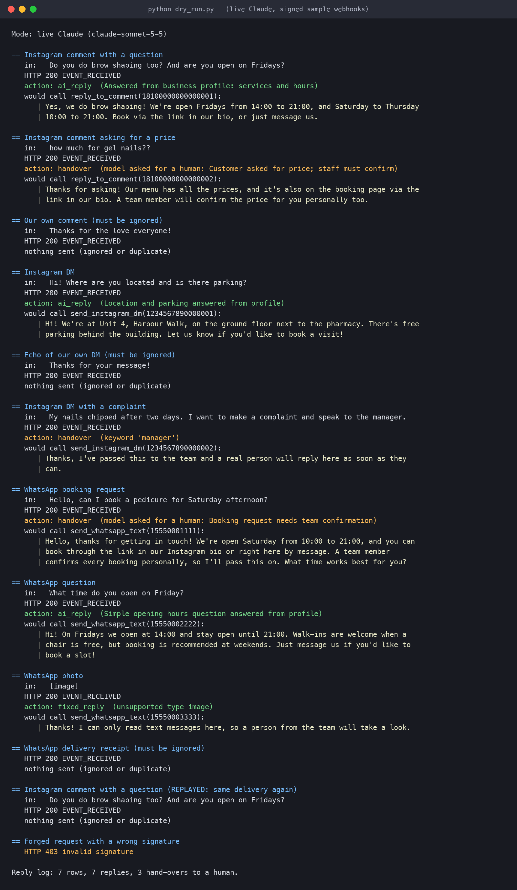
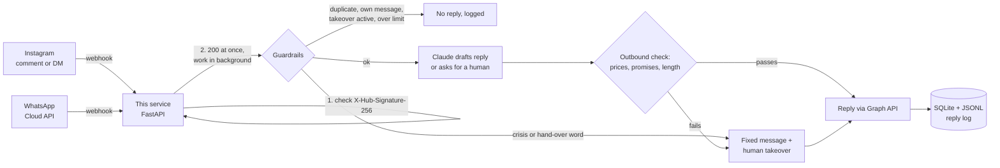

# Meta Instagram + WhatsApp Assistant

A webhook service that answers Instagram comments, Instagram DMs and WhatsApp messages for a small business using Claude, behind hard guardrails: no prices, no promises, a hand-over to a real person on the right keywords, rate limits, and a log of every reply. WhatsApp runs on Meta's own **WhatsApp Cloud API**, so no Twilio or other middleman is needed.



*A real run on the sample payloads with live Claude (Sonnet 5.5): signed webhooks in, guardrail decisions and the replies that would be sent out.*

## How it works



1. Meta POSTs each event to `/webhooks/instagram` or `/webhooks/whatsapp`. The service checks `X-Hub-Signature-256` (HMAC-SHA256 of the raw body with the app secret) before it parses anything, answers `200` straight away and does the real work in a background task.
2. Events are parsed: comments, DMs and WhatsApp messages become one simple event type; delivery receipts, read receipts and echoes of our own messages are dropped.
3. Plain-code checks run before the model is ever called: dedupe, own-account filter, optional WhatsApp allowlist, active human takeover, crisis and hand-over keywords, per-person hourly limit and a daily cap.
4. Claude (`claude-sonnet-5-5`) gets the business profile, the last few turns of that person's conversation (DMs and WhatsApp only) and the new message. It returns JSON: the reply, a `handover` flag and a short reason for the log.
5. The draft is checked again in code for anything that looks like a price, a discount or a promise, and for the channel's length limit. If it fails, a safe hand-over message goes instead and the blocked draft is kept in the log.
6. The reply goes out through the Graph API (comment reply, Instagram DM, or WhatsApp text with a read receipt), and the exchange is written to the log.

## Guardrails

| Rule | Where | What happens |
|---|---|---|
| Signature check | every POST | Wrong or missing `X-Hub-Signature-256` gets `403`; nothing is parsed or queued |
| Dedupe | every event | Meta retries deliveries for up to 36 hours; each comment/message ID is answered once |
| No reply loops | Instagram | Our own comments and DM echoes (`is_echo`) are ignored |
| Allowlist | WhatsApp, optional | Only listed numbers get replies; others are logged and ignored |
| Crisis words | before the model | Fixed safe message, human takeover, alert hook fires |
| Hand-over words | before the model | "manager", "complaint", "refund", "human"... get a fixed message and the bot goes quiet for that person (24 h by default) |
| Model hand-over | after the model | Claude flags bookings, complaints and anything it isn't sure of; a person takes over |
| No prices or promises | after the model | Currency amounts, "% off", "guarantee", "refund", "ready by Friday" and similar are blocked in code, whatever the model says |
| Length | after the model | 300 bytes for public comments, 1000 for Instagram DMs (Meta's limit), 1500 for WhatsApp |
| Rate limits | before the model | 5 replies per person per hour, 200 per day (both configurable) |
| Reply log | always | Every reply, skip, block and error, with the reason, in SQLite and a JSONL file |

Customer text is wrapped in tags and treated as data; the model is told never to follow instructions inside it. The business profile (`samples/business_profile.example.md`, a fictional nail studio) is the only source of facts.

## Run it without a Meta account (dry run)

```bash
python -m venv .venv && source .venv/bin/activate
pip install -r requirements.txt -r requirements-dev.txt

python dry_run.py --offline     # whole pipeline on samples/, canned AI step, no keys needed
export ANTHROPIC_API_KEY=...    # optional
python dry_run.py               # same, with real Claude replies
pytest                          # 41 tests, Graph API and Claude mocked
```

The dry run signs each sample the way Meta does, posts it to the real FastAPI app, prints the guardrail decision and the Graph API call it would make, replays a delivery to show the dedupe, and sends one forged request to show the `403`.

## Run it for real

```bash
cp .env.example .env            # fill in secrets and IDs (see META-SETUP.md)
./run.sh                        # listens on 127.0.0.1:8000
cloudflared tunnel --url http://127.0.0.1:8000   # or any HTTPS host / reverse proxy
```

Then in the Meta App Dashboard set the callback URLs to `https://<public-url>/webhooks/whatsapp` and `https://<public-url>/webhooks/instagram`, with the same verify token as `META_VERIFY_TOKEN`, and subscribe to the `messages` field (WhatsApp) and the `comments` and `messages` fields (Instagram). [META-SETUP.md](META-SETUP.md) has the step-by-step version. `tools/send_signed_webhook.py` signs a sample with your secret and posts it to any URL, for testing a deployed endpoint.

Set `DRY_RUN=true` to run the whole thing live but only log what it would send.

## Why this design

- **Answer first, think later.** Meta treats slow responses as failures and retries them. The handler only verifies and queues; the model call runs after the `200`.
- **Rules in code, not just in the prompt.** The prompt asks the model not to quote prices or make promises, but the outbound check enforces it anyway. A prompt can be argued with; a regex can't.
- **Silence over guessing.** Errors in the AI step or the send step never become a `5xx` (which would make Meta retry and risk a double reply). They're logged, and the reply text is kept even if delivery failed.
- **One business profile file.** Swapping the demo salon for a real client means editing one Markdown file.
- **Swappable AI.** The handlers only need an object with a `draft()` method. `AnthropicReplier` is the default; another provider is one small class.
- **WhatsApp without a middleman.** This replaces the Twilio transport in the earlier [whatsapp-reply-bot](https://github.com/ParishSynthMind/whatsapp-reply-bot) with Meta's own Cloud API, and keeps its ideas: optional allowlist, conversation memory per sender, clean failure handling, every exchange logged. Memory now lives in SQLite (last 10 turns per person) instead of an agent session, which suits a stateless web service better.

## Meta's limits (honest notes)

Checked against Meta's developer docs in November 2026:

- **WhatsApp test number:** free, but it can only message up to 5 phone numbers you've verified in the dashboard. Free-form replies are only allowed within 24 hours of the customer's last message; starting a conversation needs an approved template. Going live with a real business number needs business verification and a payment method on the WhatsApp Business Account.
- **Instagram comments:** comment webhooks need **Advanced Access** to the comments permission, which means **Meta App Review**, and the Instagram account must be public. In development mode the app can only be tested with accounts that have a role on the app.
- **Instagram DMs:** you can only reply within 24 hours of the person's last message (7 days with the human-agent tag). Each DM is limited to 1000 bytes.
- **Tokens:** the long-lived Instagram token lasts 60 days and must be refreshed; for WhatsApp, use a System User token for anything beyond a test, because the temporary token in the dashboard expires after 24 hours.

## Status

- **41 unit and integration tests pass** (Graph API and Claude mocked), on Python 3.11 and 3.12 in GitHub Actions.
- **Tested live on 1 November 2026, Claude side:** the dry run with real Claude (Sonnet 5.5) answered the location, hours and services questions from the business profile, handed the price question and the booking request to a person, and the keyword and outbound checks behaved as listed above. One real fix came out of it: the first version of the price rule also blocked harmless lines like "prices are on the menu", so it now needs an actual number.
- **Tested live on 1 November 2026, network side:** the server ran behind a Cloudflare quick tunnel and was hit over public HTTPS: verification handshake (`200` with the right token, `403` with a wrong one), a forged POST (`403`), and signed WhatsApp and Instagram payloads (`200`, real Claude replies in the log, `DRY_RUN` so nothing went to Meta).
- **Not yet run against Meta's live Graph API.** The Meta developer app, the WhatsApp test number and the Instagram professional account were still being set up when this was published. The Graph API calls are built to Meta's documented request shapes and covered by mocked tests, but they haven't sent a real message yet. This section will be updated with the live result.
- Not covered: load, long-running hosting, Instagram story mentions and media (images, voice notes) beyond a polite "text only" reply.

## Stack

Python · FastAPI · Meta Graph API v26.0 (Instagram API with Instagram Login, WhatsApp Cloud API, webhooks) · Anthropic Claude API (structured outputs) · SQLite · pytest · GitHub Actions

---
Part of a small portfolio of tested automation/AI builds; see [ParishSynthMind](https://github.com/ParishSynthMind) for the others.
